# MDEV

A modern development platform designed to progressively automate complex software development through increasing levels of orchestration and abstraction, reducing manual intervention and accelerating delivery.

<br>

**Demo video:** Coming soon.

## Core Capabilities

- **Inference & Agent Orchestration:** Provide a unified execution layer for language models and agents, managing their inputs and outputs while coordinating development workflows independently of the underlying inference provider.

- **Natural-Language Development:** Direct and manage software development through natural language, from requirements to production, across teams and repositories from a central web deployment.

- **Parallel Development:** Design, develop, test, and review changes in isolated feature streams and integrate their changes.

- **Enterprise Governance:** Enforce structured execution, controlled permissions, auditability, and recovery.

- **Cost & Value Attribution:** Track inference usage, costs, and development activity across capabilities, workflows, features, users, teams, and organizations.

- **Organizational Intelligence:** Own and centralize AI interactions across all inference providers and execution methods, turning inputs, outputs, decisions, and outcomes into institutional knowledge that compounds with every development cycle.

## Architecture

MDEV uses a layered architecture to orchestrate development execution:

- **Supervisors** — Coordinate  pools of  workflows:
  - **Refine Workflows** — Define and refine features for development.
  - **Feature Workflows** — Develop refined features in parallel, isolated environments.
  - **Manual Workflows** — Support user-initiated development outside the feature refinement process.
  - **Integration Workflows** — Combine changes from feature and manual workflows.
- **Workflows** — Define repeatable development processes and execution sequences.
  - **Stages** — Organize execution steps, transitions, and validation.
    - **Capabilities** — Perform reusable development operations, invoked directly or through workflows.

## MDEV Latest 1.2.1

### Supervisor 
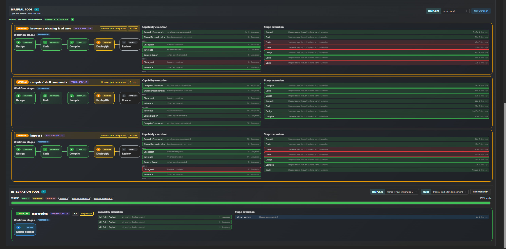
### Workflow
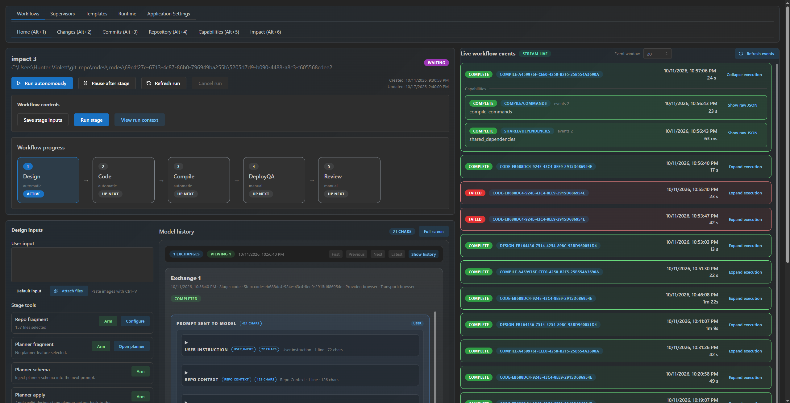
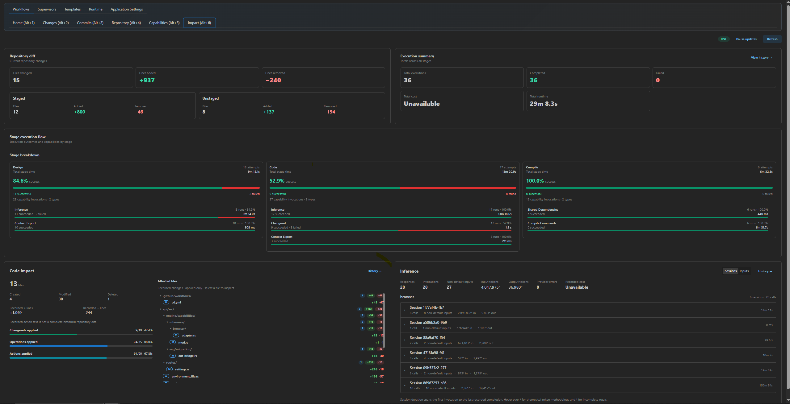
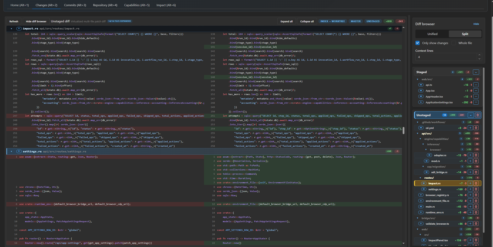
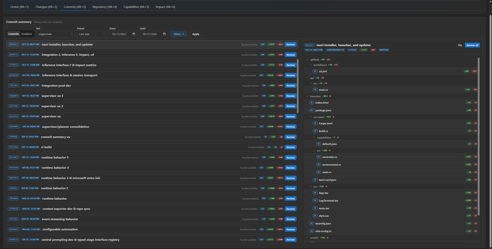
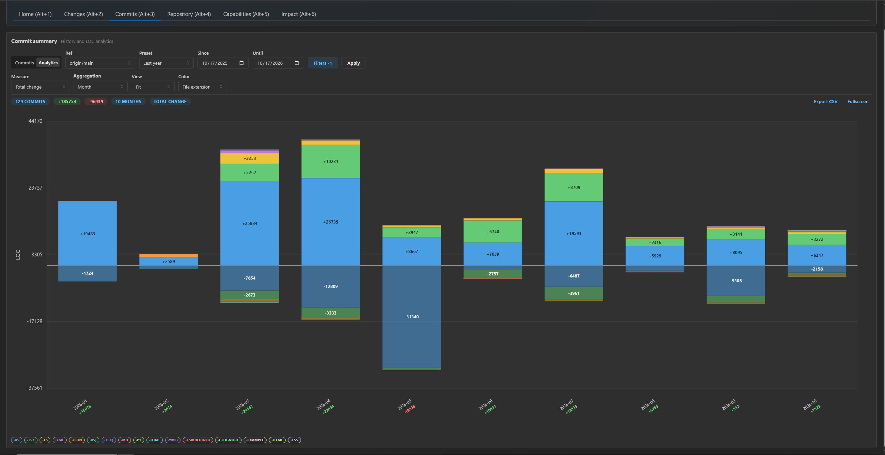
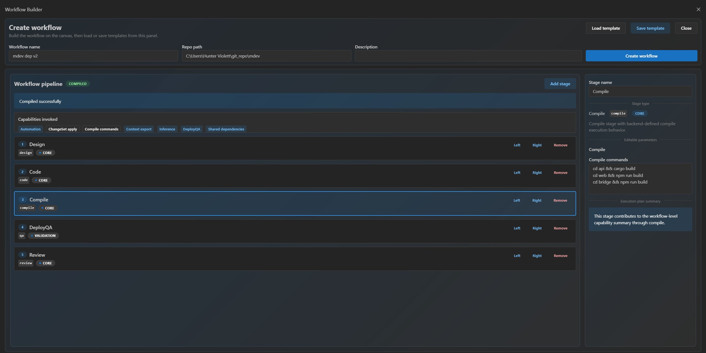
### Capabilities
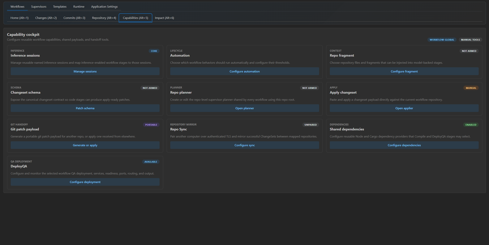
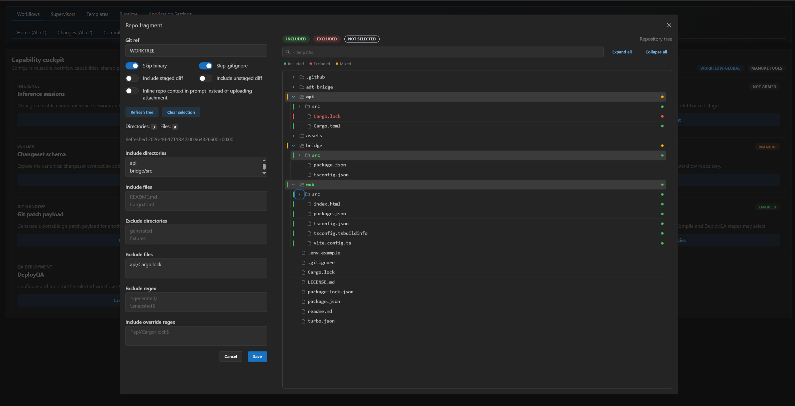
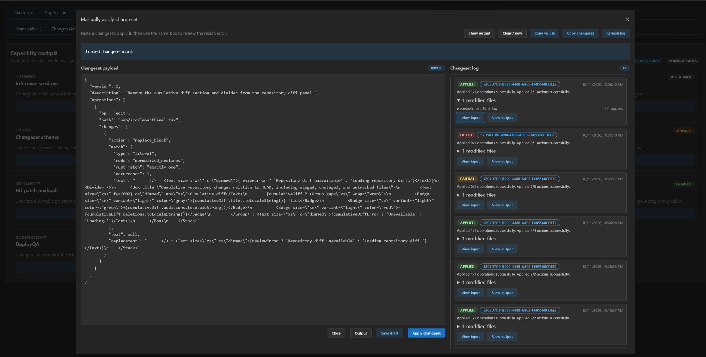
## API

```text
Supervisors
│  Coordinate parallel workflows and integrate their results.
│
├── GET  /api/supervisor-runs
├── POST /api/supervisor-runs
├── GET  /api/supervisor-runs/:supervisor_id/queue
├── POST /api/supervisor-runs/:supervisor_id/actions
│
└── Workflows
    │  Define repeatable processes, execution state, and event history.
    │
    ├── GET    /api/workflow-runs
    ├── POST   /api/workflow-runs
    ├── GET    /api/workflow-runs/:run_id
    ├── DELETE /api/workflow-runs/:run_id
    ├── POST   /api/workflow-runs/:run_id/open
    ├── POST   /api/workflow-runs/:run_id/actions
    ├── GET    /api/workflow-runs/:run_id/events
    │
    ├── Workflow Definitions
    │   ├── GET  /api/workflow-builder-catalog
    │   └── POST /api/workflow-builder/compile
    │
    ├── Capability Execution
    │   ├── GET  /api/workflow-runs/:run_id/capabilities
    │   ├── POST /api/workflow-runs/:run_id/capabilities/:capability_id/execute
    │   └── GET  /api/capabilities/changeset-schema
    │
    └── Stages
        │  Organize execution steps, transitions, and validation.
        │
        ├── Development
        │   ├── Design
        │   │   └── inference, repo_context,
        │   │       planner_fragment, planner_schema, planner_apply
        │   │
        │   ├── Code
        │   │   └── inference, repo_context,
        │   │       changeset_schema, changeset
        │   │
        │   ├── Compile
        │   │   └── shared_dependencies, compile_commands
        │   │
        │   ├── QA
        │   │   └── shared_dependencies, qa_environment
        │   │
        │   └── Review
        │       └── inference, repo_context, review_validation
        │
        ├── Integration
        │   └── Merge Patches
        │       └── git_patch_payload
        │
        └── SAP
            ├── Export
            │   └── sap/export
            ├── Import
            │   └── sap/import
            └── Syntax
                └── sap/export
```

### Capabilities

Reusable development operations that can be invoked directly or orchestrated through workflows.

| Capability | Function |
|---|---|
| **Inference & Context** | |
| `inference` | Execute AI model and agent interactions. |
| `repo_context` | Supply repository context to inference sessions. |
| `context_export` | Export repository context for development tasks. |
| **Planning** | |
| `planner_fragment` | Supply feature planning context. |
| `planner_schema` | Provide structured planning schemas. |
| `planner_apply` | Apply structured planning changes. |
| **Code & Repository** | |
| `changeset_schema` | Provide structured code change schemas. |
| `changeset` | Apply structured code and filesystem changes. |
| `repo_sync_changeset` | Synchronize changesets between repositories. |
| `git_patch_payload` | Prepare Git patches for integration. |
| **Validation & Execution** | |
| `shared_dependencies` | Prepare shared development dependencies. |
| `compile_commands` | Execute compilation and build commands. |
| `qa_environment` | Prepare quality assurance environments. |
| `review_validation` | Validate development changes and reviews. |
| **Human Intervention** | |
| `operator_checkpoint` | Request user input during execution. |
| **SAP** | |
| `sap/export` | Export SAP development objects. |
| `sap/import` | Import SAP development objects. |

### Automation

Configurable policies that respond to execution events, automate recovery, and control workflow progression.

| Automation | Function |
|---|---|
| Inference Session Initialization | Inject configured context and schemas into new inference sessions. |
| Changeset File Recovery | Inject relevant file context after repeated changeset failures. |
| Changeset Context Recovery | Inject broader repository context after repeated failures. |
| Changeset Schema Recovery | Reintroduce changeset schemas after errors. |
| Changeset Failure Threshold | Pause execution after repeated changeset failures. |
| Compile Failure Threshold | Pause execution after repeated compilation failures. |

Automation policies operate across stages and capabilities rather than belonging to a single execution stage. They support configurable recovery behavior and human intervention when required.

## MDEV Legacy 1.0.2
A desktop application with a collection of disconnected capabilities to manually interface with language models and agents

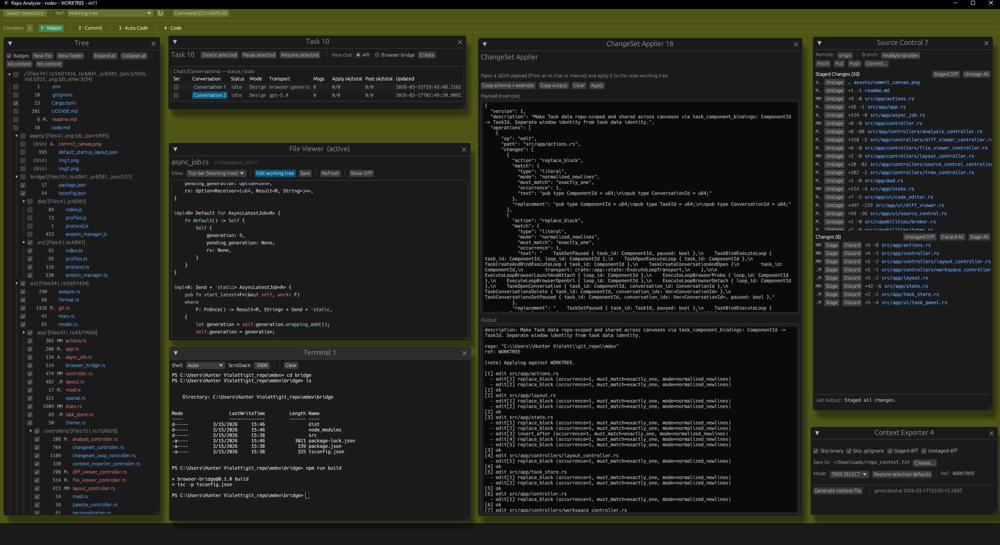

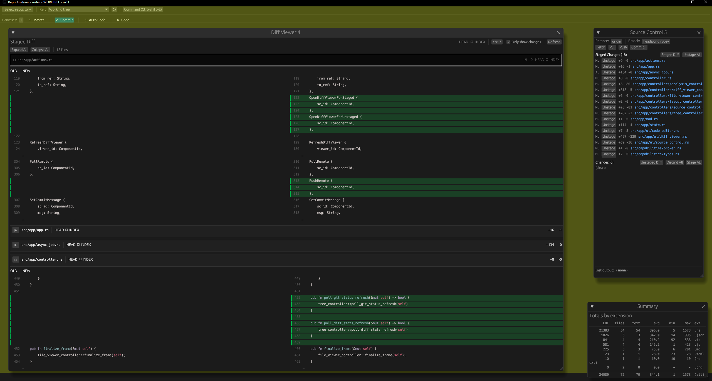
